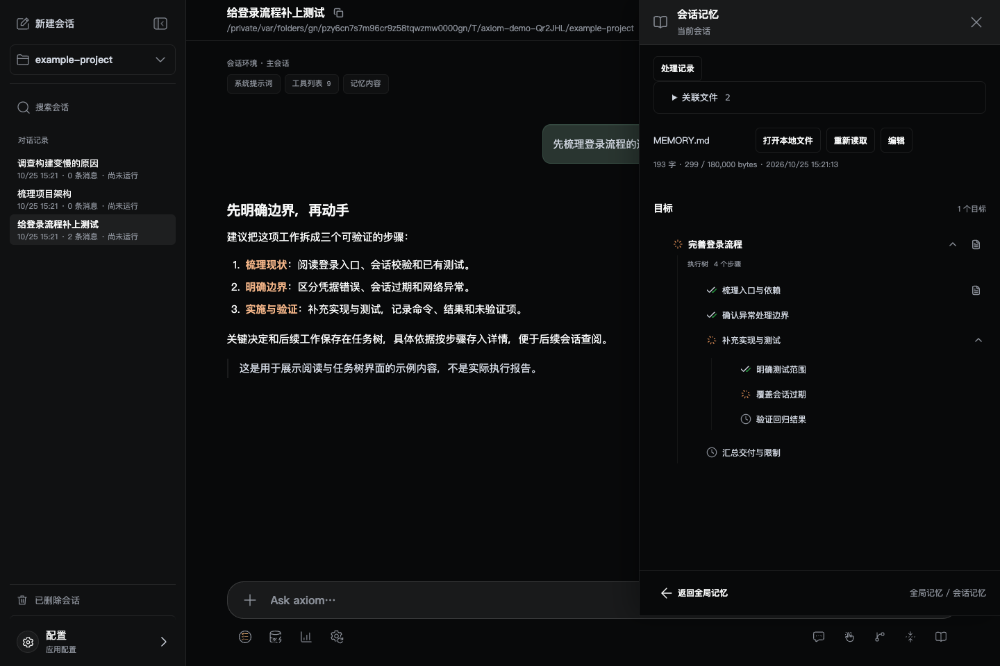

<div align="center">


# Axiom2

### 让 AI 工作，能看见，也能接着做。

**面向长任务的本地 AI 编程工作台。**<br>
把项目、对话、任务进度和可复用的经验，放进同一个工作界面。<br>
**电脑上启动，手机上接着做。** 支持 Windows、macOS 与 Android，离开桌面也能查看进度、继续下达任务。

Local-first AI coding workbench for long-running projects.

[快速开始](#快速开始) · [下载客户端](#客户端) · [为什么用 Axiom2](#为什么用-axiom2) · [使用文档](#文档与反馈)

[](https://github.com/cosyeezz/axiom2/releases/latest)
[](https://nodejs.org/)

</div>

你不缺一个能回答问题的 AI。你需要的是：**它做到哪里了、为什么这样做、下次能不能接着推进。**

Axiom2 基于 [Pi](https://github.com/earendil-works/pi) 构建：主代理负责实施，子代理协助调研与验证；任务以状态树呈现，重要决定和结果保存在本地记忆中，需要时再查询，而不只是留在一长串聊天里。



<sub>当前源码界面，使用独立临时项目与示例对话拍摄；用于展示阅读和任务树，不是实际模型执行或测试通过的证明。</sub>

> **积极迭代中。** 需要自行配置模型凭据，模型费用由对应供应商收取。当前不承诺所有供应商、OAuth 和原生客户端交互均已完成端到端验收；不同发布版本的能力以 Release 与专项说明为准。

## 为什么用 Axiom2

### 不止留下一段回答，还留下接下来怎么做

复杂工作往往要经历调查、修改、验证和返工。Axiom2 让 Agent 维护**目标 → 步骤 → 状态 → 详情**：你可以展开查看做过什么、卡在哪里，以及哪些结果还需要验证。

记忆保存在本地 Markdown 文件中，不是只能看不能带走的聊天标签。长对话压缩后，Agent 可以重新读取任务树和关键详情，找回推进工作的线索。

### 做过的调查，不必每个新会话再做一次

同一项目里已经形成的经验，可以通过 `memory_query` 按需查询。系统从已发布的分类索引逐层定位，再读取相关记忆详情，帮助后续任务复用方案、限制和踩坑记录。

**不是把全部历史塞进上下文，也不是声称“永不遗忘”。** 当前索引面向同一工作空间中结构合规、已完成的目标，后台批量整理，不保证刚写下就能立即查到；使用历史结论前仍需核对现状。[了解记忆机制 →](docs/memory-tree-query.md)

### 让主代理实施，让子代理把问题查清楚

把独立的代码调查、方案审查或测试验证交给子代理并行处理，主代理汇总证据、完成修改。你可以打开子会话查看过程、追加要求或停止任务，不必只等一个黑盒结果。

子代理定位于**调研与验证，而非多人同时改代码**；不递归委派，不加载主代理的完整资源与权限。并发数、默认模型和工作时限可配置。

### 随时随地，手机也能推进项目

不必一直守在电脑前。用 Android 客户端或手机浏览器连接电脑上的工作台，查看主／子代理进度、发送新任务或追加要求，让通勤和外出时的想法也能接上正在进行的工作。

任务仍由电脑执行，关闭手机应用不会停止后台任务。远程使用需要电脑保持开机、后台运行，手机与电脑通过同一 Tailscale 网络连通。[了解手机连接 →](app/android/README.md)

### 多个项目，一套工作台，不用反复切换工具

| 你想做的事 | Axiom2 提供的工作方式 |
| --- | --- |
| 同时推进几个项目 | 多工作空间、独立会话、搜索、置顶及运行／未读状态；切换查看不会停止后台任务 |
| 按任务选择模型 | 配置 API Key、自定义接口或 Pi 支持的 OAuth；主代理、子代理和压缩可分别选择模型 |
| 精确指出回复哪里需要调整 | 引用原文批注，统一发送意见；执行中也可追加要求 |
| 少在聊天与文件之间来回跳 | 直接预览支持的代码、文档、图片和图表；支持的文本文件可编辑 |
| 接入自己的工具 | 管理 Skills 与 MCP，按会话选择资源，并通过重新加载应用变更 |
| 知道模型调用花在哪里 | 分项查看主代理、子代理、压缩和记忆等用量；缺失价格或用量明确显示未知 |

费用统计是基于可得用量和价格的估算，不替代供应商账单。文件预览的具体格式与限制见[预览说明](docs/file-preview.md)。

## 从一个真实项目开始

Axiom2 更适合需要反复研究同一代码库、执行多步骤任务的开发者与技术研究者。第一次使用，不妨选一个可以明确验收的小任务：

```text
先梳理这个项目的登录流程和已有测试，不要急着修改。
列出异常处理的缺口，再完成必要的修改与验证。
可以把独立调查和检查交给子代理；修改由主代理完成。
把关键决定、验证结果和未完成事项记下来，方便下次继续。
```

你可以先检查任务树与执行过程，再决定是否继续扩大范围。模型输出、任务状态和“已完成”标记都需要结合真实文件及验证结果判断。

<a id="一行安装与客户端下载"></a>

## 快速开始

### 1. 下载客户端，用安装管理完成准备（推荐）

下载并打开 **[Windows 安装版](https://github.com/cosyeezz/axiom2/releases/download/v0.4.16/Axiom2.msi)** 或 **[macOS 通用版](https://github.com/cosyeezz/axiom2/releases/download/v0.4.16/Axiom2.dmg)**，在客户端内完成安装，不必先到终端逐项配置。

1. 展开 **「安装与准备」**，按提示检查并安装运行环境；缺少 Node.js 时，可点击 **「安装 Node.js」**。
2. 在 **「后台服务」** 中点击 **「安装并启动服务」**，等待安装和校验完成。
3. 点击 **「连接」** 进入工作台。已有后台时，可以跳过安装直接连接。

需要 Node.js 22.19.0+ 与 npm，客户端可协助安装；请保持联网并完成系统请求的安装授权。Windows 客户端需要 WebView2；当前安装包未签名／未公证，首次打开的系统提示见下方[客户端说明](#客户端)。

### 2. 选项目，配模型，发出第一个任务

1. 点击 **「打开文件夹…」**，选择你信任的本地项目。
2. 进入 **「配置 → 模型服务」**，添加自定义接口与 API Key，或选择当前 Pi 支持的 OAuth 登录方式，保存配置。
3. 回到会话，选择可用模型和思考等级，发送任务。

打开工作台不要求注册 Axiom2 账户；模型供应商的认证仍然需要。选择项目即授权 Agent 访问该目录，请先阅读下方[安全边界](#安全与当前边界)。

### 3. 电脑启动，手机接着做

安装 **[Android 客户端](https://github.com/cosyeezz/axiom2/releases/tag/v0.4.12)**，让手机与电脑登录同一 Tailscale 网络，连接电脑后台，即可在手机上查看进度、发送任务。手机浏览器也可访问同一工作台地址。[手机连接指南 →](app/android/README.md)

下次使用，在桌面客户端启动后台并连接即可；工作台内的 **「服务与更新」** 可返回服务管理。关闭浏览器或客户端**不会停止电脑上的后台任务**，但电脑和后台必须保持运行，服务不会自动注册开机启动。停止任务或后台不等于撤销已发生的文件修改。

<details>
<summary>Linux / 偏好终端？使用命令行安装</summary>

先安装 [Node.js 22.19.0 或更新版本](https://nodejs.org/)，确保 `node` 和 `npm` 可用，无需先安装 Git、Rust 或 Pi。

**macOS / Linux：**

```sh
curl -fsSL https://raw.githubusercontent.com/cosyeezz/axiom2/master/install.sh | sh
```

**Windows PowerShell：**

```powershell
irm https://raw.githubusercontent.com/cosyeezz/axiom2/master/install.ps1 | iex
```

脚本安装最新 Release 的后台包并启动服务，完成后打开 **[http://127.0.0.1:4317/](http://127.0.0.1:4317/)**。一行命令会下载并执行远程脚本，建议先审阅 [install.sh](install.sh) / [install.ps1](install.ps1)；也可以直接使用 npm 安装发布包：

```sh
npm install -g https://github.com/cosyeezz/axiom2/releases/latest/download/axiom2.tgz
axiom2 start
```

日常管理：`axiom2 start` 启动、`axiom2 status` 查看状态、`axiom2 stop` 停止后台（会中断活动执行）。安装路径由 npm 全局配置决定；无写权限时使用用户级 Node.js 安装或 npm prefix。校验文件和版本说明见 [Releases](https://github.com/cosyeezz/axiom2/releases)。

</details>

## 客户端

**推荐 Windows / macOS 用户通过桌面客户端安装和管理后台，再按需连接手机。** Linux 或偏好终端的用户可使用上方折叠项中的命令行安装，通过浏览器访问。

| 平台 | 入口 | 使用条件 |
| --- | --- | --- |
| Windows x64 | [安装版 MSI](https://github.com/cosyeezz/axiom2/releases/download/v0.4.16/Axiom2.msi) · [便携版 EXE](https://github.com/cosyeezz/axiom2/releases/download/v0.4.16/Axiom2.exe) | 客户端 v0.4.16；需要 WebView2，当前未签名 |
| macOS Apple 芯片 / Intel | [通用版 DMG](https://github.com/cosyeezz/axiom2/releases/download/v0.4.16/Axiom2.dmg) | 客户端 v0.4.16；ad-hoc 签名，未获 Apple 公证 |
| Linux x64 | [DEB 安装包](https://github.com/cosyeezz/axiom2/releases/download/v0.4.16/Axiom2-Linux-x64.deb) · [可执行文件](https://github.com/cosyeezz/axiom2/releases/download/v0.4.16/Axiom2-Linux-x64) | 客户端 v0.4.16；基于 Ubuntu 22.04 构建，需图形桌面及系统依赖 |
| Linux ARM64 | [DEB 安装包](https://github.com/cosyeezz/axiom2/releases/download/v0.4.16/Axiom2-Linux-arm64.deb) · [可执行文件](https://github.com/cosyeezz/axiom2/releases/download/v0.4.16/Axiom2-Linux-arm64) | 客户端 v0.4.16；基于 Ubuntu 24.04 构建，需图形桌面及系统依赖 |
| Android 8.0+ | [APK 下载与发布说明](https://github.com/cosyeezz/axiom2/releases/tag/v0.4.12) | 客户端 v0.4.12；连接电脑后台，不在手机本地执行任务 |
| 电脑 / 手机浏览器 | 后台运行后，打开本机地址或可达的 Tailscale 地址 | 后台所在电脑需要 Node.js；Linux 原生目录选择另需图形桌面与 GTK 依赖 |

Windows 安装包当前未签名。macOS 安装包为 ad-hoc 签名、未获 Apple 公证，首次打开如被阻止，可在「系统设置 → 隐私与安全性」中确认「仍要打开」；仅对确认来源可信的安装包操作。

**后台与客户端独立发布。** 客户端安装管理与命令行安装均获取后台最新 Release；桌面和 Android 链接指向各自已有安装包的版本，最新后台发布页不一定包含客户端。

手机与电脑加入同一 **Tailscale** 网络后，可在 Android 客户端连接电脑上的工作台：发送任务、查看主／子会话、选择模型，任务仍由电脑执行。连接方式、扫码和原生功能以所装 APK 版本为准。[Android 与内网连接指南 →](app/android/README.md)

Linux 推荐通过系统包管理器安装 DEB，由它解析 GTK 3、WebKitGTK 4.1 等依赖；单独的可执行文件仍需相同系统依赖，并需手动赋予执行权限。Linux 安装包已通过架构、版本和无显示器后台维护入口检查，不代表已在所有发行版或图形桌面完成交互验收。

Windows 安装包当前未签名；macOS 采用 ad-hoc 签名、未获 Apple 公证，首次打开可能出现系统安全提示。安装前请核对 [SHA256 校验文件](https://github.com/cosyeezz/axiom2/releases/download/v0.4.16/SHA256SUMS) 与 [v0.4.16 发布说明](https://github.com/cosyeezz/axiom2/releases/tag/v0.4.16)。Android 继续独立交付 v0.4.12，不重新签发。当前没有已发布的 iOS 原生客户端。

## 安全与当前边界

本地优先，是让工作台和资料由你管理，**不代表完全离线，也不代表自动拥有安全沙箱。**

- **模型请求仍可能离开本机。** 对话和工具读取的内容会按执行需要发送给你配置的模型服务；Skills、MCP 及其他集成也可能连接外部服务。
- **只打开信任的项目。** 主代理可读取和修改文件、执行命令；项目扩展与设置可能被加载。子代理有工具白名单和职责约束，但命令工具不是操作系统级只读沙箱。
- **只对受信设备开放后台。** 本机与 Tailnet 工作台没有独立应用登录，远程访问依赖 Tailscale 网络与 ACL；不要将业务端口直接暴露到公网。
- **停止不是回滚。** 已修改的文件和外部副作用不会自动撤销，建议在版本控制下工作；凭据存储也不承诺系统密钥库或磁盘加密。
- **仍在持续验证。** 真实供应商／OAuth、完整原生交互、长期记忆召回质量与大规模负载仍有待验证范围，不将本地测试等同于全面生产验收。

完整的安装、更新、数据位置、恢复机制和验收边界保留在[工程参考](REFERENCE.md)中。该文档含历史版本信息，当前专项机制请优先查看下方对应说明。

## 从源码运行

需要 Node.js 22.19.0+ 与 npm，在仓库根目录执行：

```sh
git clone https://github.com/cosyeezz/axiom2.git
cd axiom2/app
npm ci
npm run build
npm start
```

然后打开 `http://127.0.0.1:4317/`。开发模式可用 `npm run dev`；`npm start` 使用编译产物，修改源码后需重新构建并重启后台。不要在活动任务中途重启，也不要让多个服务共用同一数据目录。

## 文档与反馈

- [工程参考与历史验收记录](REFERENCE.md)：安装细节、数据目录、恢复及平台边界。
- [任务树与记忆维护规范](docs/memory-title-details-system-prompt.md)：目标、六态步骤与按需详情。
- [跨会话记忆与查询机制](docs/memory-tree-query.md)：索引范围、批处理、查询与当前限制。
- [子代理协作](docs/subagent-optimization.md)：调度、追加要求、结果与恢复。
- [文件预览](docs/file-preview.md) · [模型配置覆盖](docs/model-overrides.md) · [Android 连接](app/android/README.md)。

遇到问题或有想尝试的场景，欢迎[提交 Issue](https://github.com/cosyeezz/axiom2/issues)。请附操作系统、后台／客户端版本、复现步骤及脱敏日志；不要上传 API Key、OAuth 凭据或完整私有会话。

**如果 Axiom2 正好解决了你的工作流问题，欢迎 Star 关注后续版本，也欢迎分享你用它推进了什么项目。**

<sub>许可状态：本仓库尚未提供项目开源许可证，package.json 标记为 UNLICENSED；不应将公开可见等同于获授开源使用、修改或分发许可。第三方组件遵循各自许可证。</sub>
