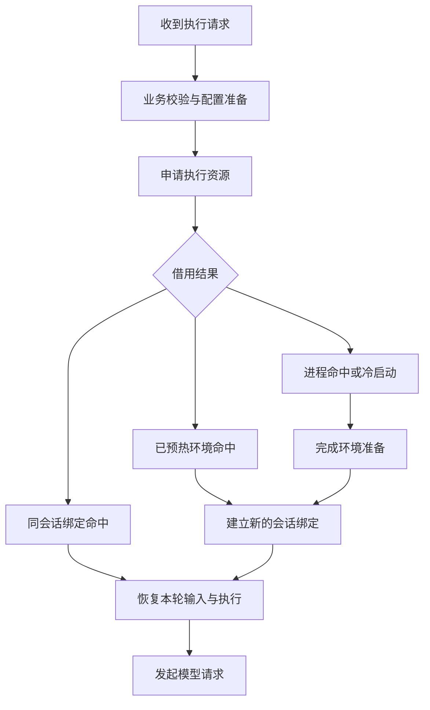
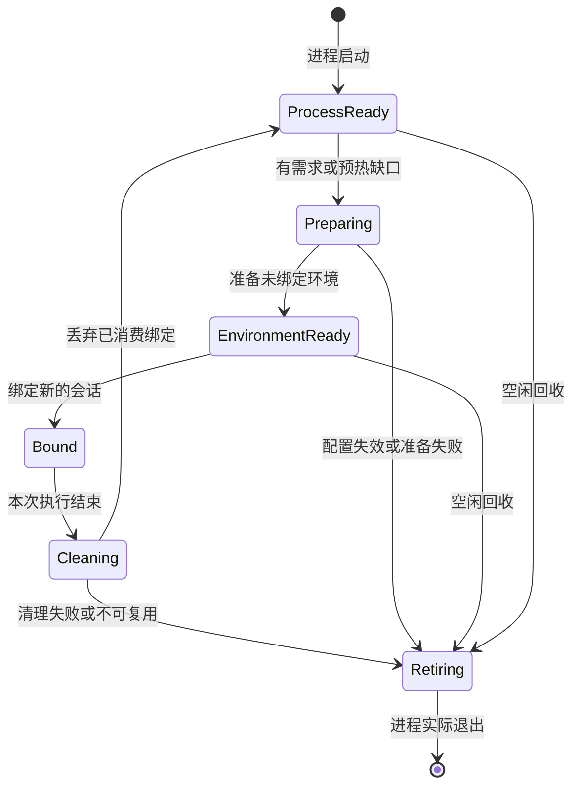

# Axiom2 pi 执行环境池化与会话启动延迟优化实施方案

**状态：实施与验收契约。** 本文以已复核的 Axiom2 代码及 pi SDK 1.1.0 为基线，规定目标结构、改造步骤和验收方法。当前实现范围、验证结果及未完成项统一维护于 [执行池说明](pi-execution-pool.md)；本文中的基线引用和目标清单不能作为当前验收通过证明。

**主目标：通过提前准备和重复使用执行资源，降低用户发起执行后、模型请求发出前的本地等待时间。** 保留现有同会话保活，在此基础上减少重复准备，并为新会话和固定能力短任务提供可直接借用的进程或环境。

| 项目 | 约定 |
|---|---|
| 适用项目 | Axiom2，代码根目录 `F:/Axiom2` |
| 代码复核日期 | 2026-10-18 |
| 原方案 | `F:/Axiom2/docs/pi-execution-pool.md` |
| 实施入口 | `F:/Axiom2/app/src/server` |
| SDK 基线 | 应用直接依赖的 pi 系列包为 1.1.0；实施时同时核对 lockfile 的实际解析版本 |
| 交付对象 | 后端开发者、编码 Agent、代码审阅者 |
| 发布依据 | 正确性回归通过，且生产 JS 构建的基准证明延迟收益与资源成本可接受 |

文中 `[C1]` 等标记对应附录中的代码文件、行号和修订标识；`[S1]` 等标记对应指定版本 SDK 的官方发布包源码。新增接口及文件名是实施建议，不表示仓库中已经存在。

## 1. 实施决策

本次实施采用以下确定方案。

1. **保留同会话亲和。** 同一会话的后续轮次继续使用兼容的原 worker 和 `AgentSession`。这一条已经存在，应作为性能基线继续优化。
2. **统一管理物理进程，再逐步增加预热。** 将 Agent、记忆任务和压缩摘要 worker 纳入一个进程池，保持现有 worker 入口和业务控制模块。
3. **把预热分成进程准备与环境准备。** 进程准备完成 Node 启动和模块加载；环境准备完成适配器允许提前执行的配置、模型目录和资源初始化。
4. **固定能力记忆任务先做跨任务复用。** 每次任务新建会话、工具闭包和读权限上下文，复用进程及经过验证的模型运行环境。
5. **主会话先获得进程预热收益。** 涉及项目扩展、OpenCLI、会话提示词和权限闭包的环境，先保持仅同会话复用；跨会话开放以适配器验证为条件。
6. **减少池外重复工作。** 将一次准入中的配置解析、资源扫描结果复用；在确有收益时保留同会话的增量读取游标。
7. **用分层对照决定后续投入。** 分别测量低成本优化、进程预热、环境预热的增量收益，再确定预热数量及更复杂路径的实施范围。

取消、用量归属、会话文件所有权和资源额度作为上述快路径的实现约束，集中在生命周期和验收章节说明。

## 2. 优化目标与延迟口径

### 2.1 首要指标

本次主要优化“发起执行”，包括新会话首轮、已有会话下一轮、需要启动执行器的记忆任务。点击会话后读取历史列表、前端绘制和模型服务自身的生成速度属于不同的耗时来源，应单独测量。

服务端请求路径可按以下阶段理解：

定义：

- `T_prepare`：父进程收到执行请求，到观察到首次模型请求发起之间的耗时，作为主要优化指标。
- `T_first_output`：父进程收到执行请求，到收到第一个有效流式输出之间的耗时，作为响应路径辅助指标。
- `T_queue`：等待可独占的兼容实例或真实创建名额的时间。
- `T_ready_wait`：本次调用 `ensureReady()` 到其完成的父进程实际等待时间；已经就绪时近似为零。
- `T_bind`：worker 内建立本次会话、工具及订阅的时间。
- `T_history`：本次执行恢复会话上下文、读取待处理持久化输入的时间。

`T_prepare` 包含池外工作。worker 阶段耗时只用于解释整体耗时，不与父进程阶段机械相加。计时实现和多进程时钟约定见第 12 节。

首轮基准只统计新启动执行及完全空闲后的新轮次。活跃会话追加输入可能与工具循环、总结或其他输入共同进入后续模型调用，暂不混入这一分布；有了输入持久化／消费位置与模型请求的可靠对应关系后，再单独统计其等待。

### 2.2 各条路径的预期收益

| 路径 | 本次可以降低的成本 | 请求到来后仍需完成的工作 |
|---|---|---|
| 同会话连续交互 | 重复配置解析、重复资源扫描、重复全量输入读取 | 当前配置校验、本轮输入受理和执行 |
| 新会话，进程已预热 | Node 启动、SDK 模块加载 | 未完成的环境准备、新会话绑定 |
| 新会话，环境已预热 | 进程启动以及已提前完成的安全环境初始化 | 新会话绑定、真实历史和输入恢复 |
| 固定能力记忆任务 | 每任务 fork、模块加载、可复用的模型环境准备 | 新建内存会话、当前候选资料与读取预算绑定 |
| 压缩摘要 | 摘要 worker 的启动和可提前完成的固定准备 | 当前快照、摘要会话、结果验证与应用 |

预热将工作移到请求之前，并不自动消除 CPU 消耗；真正复用才可能减少总重复计算。必须同时报告请求延迟和包含预热的资源成本。

## 3. 当前代码基线与改造位置

### 3.1 已经存在的复用

`AgentRuns` 已按 `sessionId` 保存空闲 worker。当前空闲保留上限为 10，15 分钟约束包含基于 `bornAt` 的绝对存活窗口；再次归还并不会无限续期。命中还要满足身份、会话文件、连接状态等条件。因此，同会话基线应使用现有保活实现。`[C1:32–43, 89–102, 234–258]`

`agent-worker.ts` 在已有 `session` 时，走更新模型／思考等级和刷新上下文的分支，不再走首次 `createAgentSession`。池化改造应保留这种语义，不应每轮都销毁后重建。`[C2:481–656]`

### 3.2 仍然位于请求路径上的准备

| 代码位置 | 当前行为 | 实施动作 |
|---|---|---|
| `agents.ts` | 配置查询、会话文件检查、模型配置快照、创建 Run，再调用 `runs.launch` | 将资源等待放到短配置串行区之外；区分准备、准入和最终提交 |
| `agents/runs.ts` | 自己管理 fork、空闲表、回收；一次正常复用路径会在多个边界重新计算 identity | 物理生命周期迁入池；复用一次检查中的环境描述，保留必要的跨时间边界校验 |
| `agent-worker.ts` | 首次执行时创建 runtime、settings、OpenCLI 环境、loader、扩展和 session | 拆出进程启动、可预备环境、本次会话绑定 |
| `memory-runner.ts` / `memory-worker.ts` | 每个任务 fork；任务后 dispose 并断开进程 | 保持现有 Runner API，改为借用固定能力实例和逐任务新建绑定 |
| `compressions.ts` | 每次摘要 fork；摘要进程退出后继续等待应用安全点 | 先纳管，摘要租约只覆盖摘要执行；按测量结果决定环境复用 |
| `models.ts` / `model-service.ts` | 创建模型 runtime、读取配置与认证；模型配置写入有串行机制 | 保留配置写入机制，减少同一有效快照的重复准备 |

以上对应 `[C1]`、`[C2]`、`[C4]`、`[C6–C10]`。

### 3.3 优先处理的重复成本

**资源身份计算。** 当前 `identity()` 会触发 `resourceIdentity()`，后者递归检查资源并读取部分文件内容。一次正常的同会话借用和归还，可经过 `launchWorker` 初始检查、两次兼容性检查、idle 检查和 keep 检查等位置。应减少同一边界内重复扫描；不能将跨执行前后的检查一并删除。`[C1:35–43, 240–247, 296–299, 97; C3]`

**全量 JSONL 读取。** worker 每轮重新创建 `PersistedInputCursor`，清空通知集合，并读取会话文件恢复通知状态。即使进程已经保活，这部分仍可能随历史增大。`[C2:658–666; C11]`

**固定任务初始化。** 记忆 worker 的资源集合和系统策略固定，使用内存 session、只开放 `memory_read`；它最适合首先证明跨任务复用收益。`[C7:8–14, 35–51]`

这些是源码识别出的优化位置，具体耗时占比须由第 12 节的基准确认。

## 4. 目标结构与职责

### 4.1 最小模块划分

首版增加两个核心文件；仅当消息类型已被多个 worker 复用时，再拆出一个小型协议文件。

| 模块 | 职责 |
|---|---|
| 新增 `execution-profile.ts` | 有效环境描述、资源 manifest、规范化 hash、配置版本校验和环境快照引用 |
| 新增 `execution-pool.ts` | 实例登记、创建名额、可取消准入、亲和索引、预热、归还、退出与回收 |
| 可选新增 `execution-protocol.ts` | IPC 的实例／租约信封、准备和清理事件类型 |
| 现有 `agents/runs.ts` | Run、输入回执、业务事件、停止和结算；通过池取得实例 |
| 现有 `memory-runner.ts` | `execute / stopProviders / close`、读取回调、任务截止时间和结果 |
| 现有 `compressions.ts` | 快照、摘要结果验证、应用安全点和持久化确认 |
| 现有三个 worker 入口 | 各自的准备、绑定、执行、清理；保持当前能力边界 |

不引入通用插件注册框架、第二套任务状态机或与现有业务队列平行的任务调度器。池中只保留资源分配所需的状态。

### 4.2 三层复用

| 层次 | 可以保留的对象 | 有效边界 |
|---|---|---|
| 进程层 | Node 进程、已加载模块、适配器启动代码 | 入口、构建、启动环境、cwd 等兼容 |
| 环境层 | 固定配置快照、允许保留的 ModelRuntime、下一次尚未绑定的资源准备结果 | 有效 profile 相同，适配器承诺成立 |
| 同会话层 | 当前 AgentSession、SessionManager、合法的会话内状态 | 同一会话及文件版本兼容，旧轮次完全空闲 |

**跨会话复用的是执行能力及下一份预备环境。** 每次跨会话建立新的消息历史、工具闭包、权限上下文和订阅。对只支持同会话保活的实例，hash 相同也不代表可以跨会话借用。

### 4.3 适配器能力

~~~ts
type ReuseMode = 'single-use' | 'same-session' | 'cross-binding';

type WorkerEntry = 'agent' | 'memory' | 'compression';

type ExecutionKind =
  | 'agent'
  | 'memory-query'
  | 'memory-organize'
  | 'compression-summary';
~~~

`ExecutionKind` 用于准入与业务统计，不自动进入 hash。查询与整理若有效初始化输入完全一致，可以共享记忆环境；真正改变资源、工具、策略或 provider 的字段才改变 profile。

| 执行路径 | 首次接入 | 开放后续复用的条件 |
|---|---|---|
| 主会话 Agent | 同会话亲和；未绑定进程可预热 | 会话相关扩展、工具和环境变更逐项验证后才开放跨绑定 |
| 子任务 Agent | 保持现有同任务／同会话语义，可预热进程 | role、权限、提示词和工具初始化已明确分离，无未受控扩展残留 |
| 记忆查询与整理 | 先单次纳管，随后开放固定能力跨绑定 | 固定 cwd 策略、固定 runtime 配置、逐租约内存 session 和读闭包 |
| 压缩摘要 | 单次纳管 | 证明快照相关状态全部位于绑定内，且测得足够收益 |

## 5. SDK 1.1.0 的实施边界

### 5.1 使用公开 API 提前准备

pi-coding-agent 1.1.0 已公开提供 `createAgentSessionServices` 和 `createAgentSessionFromServices`，可以先准备 cwd 相关 services，再注入真实的 `SessionManager` 和工具创建 session。`[S1:core/agent-session-services.ts:30–73, 135–233]`

仅对允许使用 `DefaultResourceLoader`、初始化不依赖未知会话参数或授权、准备阶段不触发业务动作，且失败／回收时能够清理的适配器，提前创建完整 loader。其他环境先预热进程及允许保留的 runtime。满足条件时可以采用：

~~~ts
// 示意代码：preparedSettings、loaderOptions 已由有效 profile 得到。
const services = await createAgentSessionServices({
  cwd: profile.cwd,
  agentDir: profile.agentDir,
  modelRuntime: allowedRuntime,
  settingsManager: preparedSettings,
  resourceLoaderOptions: loaderOptions,
});

// 真实任务到达后才创建本次 session。
const result = await createAgentSessionFromServices({
  services,
  sessionManager: createSessionManager(binding),
  model: selectedModel,
  thinkingLevel: binding.selection.thinking,
  tools: allowedToolNames,
  customTools: createBindingTools(binding),
});
~~~

以上函数存在于指定 SDK 版本；`profile`、`binding` 和应用辅助函数是本文提出的实现概念。

factory 返回后，继续完成原适配器的扩展和宿主绑定。原本调用 `session.bindExtensions()` 的 Agent 路径，必须等它及相关资源发现完成，再报告 `bound`；同会话亲和不每轮重放 `session_start`。固定记忆继续使用原空资源语义。创建 session 本身不能代替这一步。`[C2:620–631; S3:3258–3281]`

同会话保留原 SettingsManager；跨绑定默认按有效配置新建 SettingsManager／内存 settings，预备阶段创建的对象只供下一次绑定消费。仅在固定适配器禁止运行期修改并通过测试时才允许复用。用户真正持久化的配置修改通过原失效机制形成新 profile，不作为残留强行还原。只将 profile 标为 Readonly 不会使 SDK 的可变 settings 对象自动恢复。`[S1:214–233; S3:1436–1438, 2700–2711, 3249–3250, 3824–3825]`

**固定记忆 worker 继续使用自己的空资源 loader。** `createAgentSessionServices` 内部会创建 `DefaultResourceLoader`，不能为了统一调用而引入原本禁用的项目资源。该路径可保留当前 `createAgentSession` 的显式依赖注入，将提前准备的 runtime、全新的固定 loader 和 settings 传入即可；也可通过公开的 `AgentSessionServices` 类型组织这些对象。`[C7:10–14, 38–50; S1:core/agent-session-services.ts:135–154; S2:191–207]`

### 5.2 预备环境是一次消费的，不复活旧 loader

`AgentSession.dispose()` 会使其扩展 runner 使用的 runtime 失效。默认 loader 返回自身持有的扩展结果；将一个已经被旧 session 使用并 dispose 的 loader 原样交给新 session，会带入已失效的扩展 runtime。重新绑定不会清除该失效标记。`[S3:1393–1414, 3630–3647; S4:425–426; S5]`

因此固定能力跨绑定采用以下生命周期：

一个 worker 每次只持有一份正在使用或等待使用的环境。清理后可以仅保留进程和已证明可保留的 runtime；存在实际需求或 ready 缺口时才准备下一份环境。首版不在执行中的实例旁额外准备第二份完整环境，避免并发修改 runtime 和增加不必要的内存占用。预热目标以“可借用的未绑定环境”为单位，不以已分配但尚未就绪的数量冒充命中。

未绑定的预备环境也要有适配器明确的清理方法。SDK 没有通用的 loader dispose 屏障；未消费准备无法确认已清理时，退出进程，不通过创建假 session 触发清理。

对于默认 loader，优先新建 loader／扩展实例。指定版本的 SDK 能按 cwd 缓存扩展 factory，新 loader 的首次加载可以利用模块缓存；同一个 loader 再次 reload 则会清理扩展缓存。这个行为不能解释为任意扩展的模块级变量都已隔离。`[S4:509–514; S5:extensions/loader.ts:129–150, 559–625]`

### 5.3 ModelRuntime 的复用条件

`AgentSession.dispose()` 不会调用 `ModelRuntime.dispose()`；但 ModelRuntime 本身含认证覆盖、provider 注册和 virtual-model 路由等可变状态，不能当成无条件共享的只读目录。`[S3:1393–1414; S6]`

首版仅在下列条件同时满足时保留它：

- 有效 profile 未变化，配置与认证版本仍兼容。
- 不存在租约级 runtime API key 覆盖。
- 没有捕获会话输入、权限或回调的 provider／virtual-model 注册。
- 适配器不允许任务任意改写共享模型运行环境。
- 上一租约的模型调用和认证操作已经结束。

固定记忆适配器可以首先满足这份契约。主扩展环境暂不能证明时，保留进程收益，runtime 在绑定时重新创建，或者维持同会话亲和。

### 5.4 正确理解释放和连接收益

`dispose()` 是同步函数，不是等待工具和请求结束的异步屏障。正常结束应先等待 SDK 和应用输入队列空闲；替换 session 时完成适用的 shutdown handlers，再 dispose。取消时先 abort 并等待；清理失败直接退役。`[S3:1393–1414, 2434–2450; S7:167–177]`

SDK 的 session 资源清理还会关闭部分按 sessionId 保存的连接，例如指定版本 pi-ai 的 Codex WebSocket。因此文档和基准只计算实际保留下来的资源，不承诺跨会话保留所有 HTTP、TLS 或 WebSocket 连接。`[S8]`

## 6. 有效环境与 profileHash

### 6.1 两类输入分开

| 环境准备输入：决定能否复用 | 本次绑定输入：逐任务提供 |
|---|---|
| schema、应用构建、SDK 和适配器版本 | sessionId、runId、taskId、requestId |
| worker 入口、Node 启动参数、相关 env | prompt、附件、图片、当前输入队列 |
| 有效 cwd、agentDir、资源解析方式 | 指定会话 JSONL 文件和本次文件版本 |
| 工具集合、固定策略及初始化级权限 | 本次细粒度授权、候选路径、读取预算 |
| 实际启用的资源内容及有意义的顺序 | 用量归属、取消信号、deadline、工作预算 |
| 初始化所用 settings、基础提示词 | 会话提示词、任务角色中仅在绑定使用的部分 |
| 有效模型／provider 配置、认证域及版本 | 工具 execute 闭包、事件订阅、结果接收者 |

字段在哪个阶段被消费，就按那个阶段确定兼容性。若任务 role 已被捕获在 loader 的初始化提示词或扩展 factory 中，应把它的有效策略放入 profile；完成解耦后才可移到绑定。不能仅依据字段名判断。

随机模型快照路径、随机压缩文件名和单次请求 ID 不进入 hash；应使用其真正影响环境的内容和版本。`[C3; C4:367–369; C8:177–182; P:57–109]`

### 6.2 建议的数据结构

~~~ts
interface EnvironmentProfile {
  schemaVersion: number;
  buildId: string;
  sdkVersions: Readonly<Record<string, string>>;
  adapterVersion: string;

  entry: WorkerEntry;
  reuse: ReuseMode;
  cwd: string;
  agentDir: string;
  spawn: Readonly<SpawnSpec>;

  effectiveSettings: Readonly<EffectiveSettings>;
  capabilityDigest: string;
  basePromptDigest: string;
  resourceManifest: readonly ResourceManifestEntry[];

  modelConfigDigest: string;
  authDomain: string;
  authRevision: string;
}

interface PreparedEnvironment {
  profileHash: string;
  configEpoch: number;
  profile: Readonly<EnvironmentProfile>;
  snapshot: EnvironmentSnapshotRef;
}
~~~

其中 `SpawnSpec`、`EffectiveSettings` 等复用或抽取现有类型；不再建立第二套模型选择、权限和设置定义。示意类型不要求逐字实现。

### 6.3 生成流程

1. 读取本次实际会使用的配置、资源入口和权限策略，形成同一份有效输入。
2. 解析资源路径，按平台实际文件系统规则规范化；保持影响加载顺序的数组顺序。
3. 对稳定对象 key 排序，固定缺省值、空值、编码和 schema 版本。
4. 对有效资源使用内容摘要或可靠版本；时间戳只作为缓存提示，不能单独证明内容未变化。
5. 对规范化描述计算 SHA-256。
6. 使用同一份已验证输入进行 prepare。若某资源必须从原路径再次加载，则在 prepare 前后复核版本；变化时废弃本次准备，避免“hash 是旧内容、加载的是新内容”。
7. 在借用边界验证配置 epoch 与所需资源仍有效。文件 watcher 负责提示失效，不承担唯一正确性来源。

当前 `resourceIdentity` 有节点数、文件大小、符号链接及包外资源方面的边界。第一阶段保持保守失效，再逐步让 manifest 覆盖**实际启用且受支持**的资源；未支持的动态资源使适配器停留在同会话或单次模式。`[C3:6–25]`

不扫描普通项目所有源文件来构建环境 hash。普通工具稍后读取的业务文件属于任务输入；扩展模块、实际载入的 AGENTS、skills、prompts 和配置属于环境资源。

### 6.4 快照和文件生命周期

当前每个 Agent Run 生成模型配置快照，worker 与父进程又在不同结束边界删除它。长期池化后，环境引用不能继续依赖某个已经结束 Run 的临时文件。`[C1:89–102, 234–258; C4:367–408]`

实施时增加池拥有的环境快照引用：

- 模型配置以不可变快照提供给 prepare；允许按内容摘要去重。
- 引用计数覆盖准备中的实例、空闲实例、在用实例和尚未提交的准入申请。
- 最后一个引用释放后才删除文件；进程退出前不得删除它仍可能读取的环境快照。
- 会话 JSONL 仍由原会话持久化逻辑拥有，不转移到环境快照中。
- 认证仅在可信配置层使用真实内容；profile 和日志保存域、引用和不含明文凭据的版本信息。
- 模型、认证和运行时存储路径以 `ModelService.dir` 等实际配置为准，包含 `AXIOM_PI_DIR` 的有效值，不重新硬编码一套路径。

模型配置写入、认证变化、provider 可用目录变化应使相关环境失效。当前配置保存可能先发生实际写入，再在后续步骤失败；不能只在整个 save 成功返回时失效缓存。`[C9:10–26, 50–71; C10:65–89, 361–404]`

### 6.5 cwd 与跨工作空间

主／子 Agent 的资源和工具依赖项目 cwd，首版按规范化 workspace cwd 分池，不跨工作空间改写进程环境。

固定记忆 worker 当前仍以工作空间 cwd 启动。先在相同 cwd 内证明复用；只有测试确认不再依赖项目发现、相对路径和环境变量后，才改为受控的固定 cwd，开放不同工作空间之间的固定能力复用。读取权限继续使用服务端本次候选集合验证。`[C6:48–54; C7:38–50; C12:190–207]`

## 7. 最小池接口与借用协议

### 7.1 必须分开的身份

- `instanceId`：一个 worker 实例的身份。
- `generation`：实例代次；旧进程、重建和延迟事件不能混用。
- `leaseId`：一次资源占用和执行轮次。
- `SessionBinding`：属于一个真实会话的 session、工具入口及合法亲和状态。
- `profileHash`：环境兼容性。

同会话可以连续使用同一个 SessionBinding，但每轮拥有不同 LeaseScope。固定短任务每次同时新建 LeaseScope 和 SessionBinding。

~~~ts
type LeaseRef = Readonly<{
  instanceId: string;
  generation: number;
  leaseId: string;
}>;

interface AcquireRequest {
  environment: PreparedEnvironment;
  kind: ExecutionKind;
  // 在真实业务入口捕获一次，供父进程统计；不由 acquire 时刻代替。
  requestStartedAtMonoMs: number;
  affinity?: {
    sessionId: string;
    fileRevision: string;
  };
  parentLease?: LeaseRef;
  signal: AbortSignal;
  deadlineAt?: number;
}

interface ExecutionLease {
  ref: LeaseRef;
  source:
    | 'affinity'
    | 'environment'
    | 'process'
    | 'preparing'
    | 'cold';

  // 幂等。冷路径在调用时才启动已经预留的创建工作。
  ensureReady(): Promise<ReadyWorker>;

  // 清理确认或实际退出以后才完成。
  released: Promise<void>;
}

interface ExecutionPool {
  acquire(request: AcquireRequest): Promise<ExecutionLease>;
  release(
    ref: LeaseRef,
    result: { clean: true; keepSession: boolean },
  ): Promise<void>;
  retire(ref: LeaseRef, reason: string): Promise<void>;
  close(): Promise<void>;
}
~~~

`acquire()` 在**独占兼容实例或真实创建名额**时返回，不等待完整环境就绪。对本次触发的冷启动，`ensureReady()` 由业务准入、Run 激活之后的 launch 调用；已有预热可以本来就在准备中。这样能够准确区分资源排队与取得资源后的启动时间。

`release(clean: true)` 只能由服务端根据匹配当前租约的清理确认调用，业务结果完成事件不能自行证明可归池。

### 7.2 借用顺序

在满足业务额度和兼容性条件后，池按以下顺序尝试：

1. 同 profile、同会话且文件版本合法的亲和实例。
2. 同 profile、已经清理完成、允许本次绑定的环境就绪实例。
3. 同 profile、允许本次绑定的进程就绪实例。对 `same-session` 模式，这只能是从未消费过业务绑定的预热进程；已使用过的实例结束亲和后必须退役，不能通过清空 session 获得跨会话资格。
4. 同 profile、尚未被领取的预热中实例。
5. 预留新的真实创建名额。
6. 名额已满时，回收不兼容且可回收的空闲实例，为实际需求腾位。
7. 暂时不能满足时，保留在唯一的资源等待队列；支持取消及原有截止时间。

回收后必须等进程实际退出，再分配创建名额。已经有实例为同一容量缺口退出时，避免重复驱逐。回收所得槽位在真正可用后重新按可执行申请分配，不永久绑定给最早触发回收的普通请求。

### 7.3 实例状态与两种 ready

实例状态保持为 `preparing / available / leased / cleaning / retiring / exiting / exited`。准备深度和是否保留 SessionBinding 是独立属性。

| 信号 | 精确定义 |
|---|---|
| `process_ready` | IPC 可用、worker 入口及规定模块已加载 |
| `environment_ready` | 当前 profile 的允许预备部分完成，可以开始真实绑定 |
| `bound` | 当前 lease 的 session、工具与权限上下文及原本需要的扩展／宿主绑定已完成 |
| `result` | 本次业务结果已生成 |
| `cleaned` | 当前 lease 已满足归还条件 |
| `close` | 父进程观察到子进程实际关闭 |

现有 Agent 的 `ready` 包含真实 session 的环境信息，不能将进程预热阶段的 `process_ready` 当成它发送。`[C2:635–666; C1:340–346]`

### 7.4 IPC 只增加必要的信封

准备阶段消息包含 `instanceId / generation / profileHash`；绑定后所有输入、取消、工具调用、用量和结果消息再包含 `leaseId`。保留原业务消息载荷与事件语义。

长期 SessionBinding 的工具入口，在**每次工具调用进入时**同步捕获当前有效 LeaseScope；该次调用后续所有 await、回复和错误回调都持有这份不可变 scope。每轮订阅和预算定时器直接捕获本轮 scope。

不能让永久工具入口永远使用第一轮 lease，也不能让旧异步回调在发送时读取全局 `activeInput`，将旧事件重新标成新任务。跨会话必须创建新的工具入口和绑定。`[C2:259–270, 522–589]`

## 8. 预热策略与容量

### 8.1 预热什么、何时预热

第一次请求前，只预热应用已经知道有效 workspace、模型选择和能力 profile 的路径。触发点为：

- 服务启动后，已有有效配置对应的少量固定记忆环境。
- 活跃工作空间被使用、其模型选择和资源 profile 已确定。
- 实际租约借出或结束后，补充近期有需求的 profile。
- 配置变化后，根据当前需求准备新 profile，旧空闲环境退役。

不遍历所有历史会话建立进程。尚未确定配置时不构造假 profile；预热不创建业务 Run、假用户消息、会话 JSONL、模型推理请求或用量。

只允许提前执行不依赖真实绑定、且无业务副作用的初始化。可能安装包、启动外部程序或执行未知扩展副作用的步骤，仍留在经过授权的真实绑定路径；相应实例只报告已经完成的预热深度。

### 8.2 首版使用简单的需求驱动补充

维护有限数量的近期活跃 profile，以及每个 profile 的 ready、preparing、leased 数量。补充请求合并，同一缺口最多启动一项预热；失败按 profile 退避，配置变化后重新判断。

实际等待请求优先于补充工作。低需求 profile 允许 ready 目标降为 0。预热进行中也计入容量，且其可取消准备不能永久钉住同步任务需要的资源。

主会话亲和保留和未绑定预热共同占用空闲预算。保留亲和会话通常能省掉更多绑定工作，但不能使新 profile 只能等完整 TTL；压力下按兼容需求和可回收性腾位。

### 8.3 配置项及初始校准

~~~ts
interface PoolLimits {
  maxLiveProcesses: number;
  maxIdleRetained: number;
  targetReadyTotal: number;
  nestedLeafReserve: number;
  maxPrewarming: number;
  idleTtlMs: number;
  maxLifetimeMs: number;
}
~~~

还需复用业务已有的记忆并发、记忆队列、任务并发和 deadline；新增资源申请总数也应有服务端内部上限。没有总超时的业务不因引入池就新增一个任务执行超时。

**下列仅为开发与压力测试夹具，不是发布默认值：**

| 参数 | 示例值 | 解释 |
|---|---:|---|
| `maxLiveProcesses` | 8 | 包括准备、使用、清理和退出中的实例 |
| `maxIdleRetained` | 4 | 全池上限，亲和和未绑定环境共用 |
| `targetReadyTotal` | 2 | 全局小目标，按近期需求分配 |
| `nestedLeafReserve` | 1 | 仅覆盖已确认的同步叶子记忆查询 |
| `maxPrewarming` | 1 | 仅限制没有真实请求拥有的后台预热并发 |
| 空闲 TTL／最长寿命 | 沿用现有保活约束作为首轮对照 | 先测量，再调整；不可混同两种时间 |

发布配置必须在 M0–M3 的真实基准后确定并记录依据。先降低重复准备，再增加空闲数量；不要将原 Agent 空闲上限 10 直接解释成全局最大存活进程数。

启动时验证 `maxLiveProcesses > nestedLeafReserve >= 1`，以及其他限额的非负和上界关系。`maxPrewarming` 不作为真实请求 `ensureReady()` 共用的启动许可；真实请求由物理额度、普通占用额度和业务额度控制，同步叶子查询不能被不可抢占的后台预热许可挡住。

### 8.4 物理名额与嵌套执行

设 `L` 为全局存活额度，`R` 为同步叶子任务预留。保持：

~~~text
实际存活实例 + 尚未落地的创建预留 <= L

普通请求已领取且尚未释放的资源 <= L - R
~~~

普通请求包括主／子 Agent、后台整理和压缩摘要。实例启动、绑定、执行和清理期间都属于已领取；物理进程退出中仍计入存活数。

当前代码存在“Agent 持有执行资源，同时等待记忆查询”的同步调用。服务端在申请时取得真实父 Lease，并在授予资源时再次验证它仍有效，这类固定能力查询才可以使用预留容量；不得信任模型工具参数自行声明的 parent 身份。父 Lease 已结束的排队查询沿原取消语义结束。`[C4:154–168]`

`R = 1` 只覆盖“父 Agent 等待叶子记忆任务，叶子不再等待其他池执行”的已知依赖。若实施中发现更深的同步等待链，应根据真实依赖调整准入，不能宣称一个预留能处理任意嵌套。

空闲实例可占用物理空间，但必须可回收；不得因保留目标阻止必要腾位。可执行申请按已有业务优先关系和等待顺序分配，跳过暂时不可执行的队首，避免错误 profile 或普通后台请求阻挡能够使用预留的叶子查询。

### 8.5 记忆许可与池资源一次领取

原 MemoryRunner 有自己的并发和等待队列。不能保留“先占记忆并发许可，再等待全局池”的串联方式，否则等待普通资源的后台整理可能占满记忆许可，让持有父 Lease 的查询无法使用预留容量。`[C6:18–45]`

首版在池准入中加入一个固定的 memory 分组约束：

- 查询和整理进入同一个资源等待体系。
- 保持原 memory 并发上限、队列上限和错误语义。
- 能同时取得记忆许可与实例／真实创建名额时，原子地一起领取。
- 仅等待池资源的整理不占 memory 活跃许可。
- 真正运行的整理正常持有许可直到其原完成边界。
- 保留服务端 `jobs` 登记，使 provider 停止和关闭仍覆盖排队任务。

这是一组必要的计数和准入条件，不需要构建通用多资源调度框架。

## 9. 各执行路径的改造步骤

### 9.1 Agent：保留原受理语义，拆开准备与启动

当前 `agents.ts` 已在 `models.serial()` 内完成准备，并通过外部等待 completion 避免长期占用配置串行区；新增资源等待必须保持这个特点。`[C4:290–301, 434–514]`

目标顺序如下：

1. 在原每会话互斥及 epoch 下登记可停止的 `pendingStart`，每会话最多一个启动申请。登记须早于第一次可能长期等待的异步操作。
2. 对 rewrite 等会话改写路径，沿用先释放旧绑定的前置步骤，在 `models.serial()` 外等待原 session 的 shutdown／flush 完成。若适配器允许，可以保留干净的进程环境；否则退役。
3. 在短配置串行区中校验业务输入、取得有效环境快照并准备启动描述。可以预分配 Run ID，但不提前写执行 `startedAt`，不执行启动专属 rewrite。
4. 在配置串行区之外调用 `pool.acquire()`。等待资源期间子任务保持原 queued 语义，主会话由原 pending／回执机制管理。
5. 取得 lease 后，在短提交区重新检查取消信号、epoch、任务状态、配置版本、会话文件版本和原 `beforeStart` 条件。
6. 提交已授权的会话改写及原本所需持久化变更，创建／激活 Run，以这一时刻记录 `startedAt`。将 pending 原子地交接为 active，Run 同时取得 lease 所有权并安装停止／失败结算，避免 stop 查找不到两者的空窗。
7. 调用原 `onStart(run)`，再进入 `runs.launch()`，由它调用 `lease.ensureReady()`、建立或续用绑定，并执行本次输入。
8. 沿用原确认机制返回受理结果；不能因为拿到了 lease 就提前返回具有“输入已送达／已持久化”含义的 accepted。

~~~ts
// 示意控制流。现有 validate、beforeStart、受理和结算逻辑仍是权威。
const pending = registerPendingStart(scope, epoch, signal);

try {
  await releaseOldBindingIfRewrite(request);

  const prepared = await models.serial(() =>
    prepareCommandAndEnvironment(request, pending),
  );

  const lease = await pool.acquire(prepared.acquire);
  pending.attach(lease);

  const launch = await models.serial(() => {
    assertStillCurrent(prepared, pending, lease.ref);
    assertCurrentFileAndEnvironment(prepared);
    callOriginalBeforeStart(prepared);
    // 内含 lease 交接和原 onStart；onStart 异常也进入同一结算路径。
    return commitAndActivateRun(prepared, lease);
  });

  // 本次冷启动在 Run 激活后开始；已预热的实例可立即就绪。
  return await runs.launch(launch);
} finally {
  // 只回收未交接给 Run 的资源；已交接资源由原结算路径负责。
  await pending.finishOrReleaseUncommitted();
}
~~~

长资源扫描、worker ready、旧绑定释放、进程退出和池排队不得放在 `models.serial()` 内。若锁外等待期间 profile 过期，释放尚未绑定的 lease，重新取得快照和申请；尚未执行的输入不需要自动重发，已经存在不确定回执的输入沿用原判定。

交接之后，即使 `onStart` 抛错、`ensureReady` 失败或 stop 立即到达，也由 Run 的同一次 settle 回收或退役 lease；不能因为尚未 fork 就遗漏已领取的资源。

主会话后续命令继续使用原每会话串行受理；已在运行的会话将追加输入送入原输入队列，不为每条消息再申请一份 lease。不通过无条件递增 epoch 取消合法的后续输入。

### 9.2 子任务：排队不吃预算，冷启动仍计预算

当前 TaskScheduler 在 `onStart` 中根据 `run.startedAt` 设置工作开始、截止时间和计时器；该动作发生于 `runs.launch` 之前。`[C5:383–418, 465–492; C4:467–484]`

目标边界：

| 阶段 | 任务语义 | 是否消耗原 workMs |
|---|---|---|
| 原业务队列 | queued | 否 |
| 已选为候选，等待池名额 | queued；保留现有 launching／pending 去重 | 否 |
| 取得 lease，完成最终提交并激活 Run | starting | 开始计时 |
| 本次冷启动、环境准备、绑定 | starting／initializing | 是 |
| 模型和工具执行 | running | 是 |

既不能排队前写入 `startedAt`，也不能为了优化表面预算而等整个环境 ready 后才调用 `onStart`。TaskScheduler 保留原任务排序和业务并发；池只处理被原调度器选中的候选所需物理资源。

### 9.3 记忆：第一个跨绑定实现

保持 `MemoryRunner.execute()`、`stopProviders()`、`close()` 接口及现有调用关系。内部按下列步骤改造：

1. `execute()` 入口登记 job，并一次性创建原取消／超时组合信号。当前超时从准入前开始，改造后仍覆盖排队、准备、绑定、执行及原完成边界。`[C6:35–45]`
2. 用第 8.5 节的联合准入替换原本地 `admit()` 后再 fork 的方式。
3. `memory-worker` 收到 prepare 时只准备固定环境；先在同 cwd、同模型配置内复用。
4. 每个 lease 新建 `SessionManager.inMemory()`、固定资源 loader／扩展 runtime、会话 settings，以及 `memory_read` 工具闭包。
5. 每个 lease 新建 `used / turns / incomplete / usageId / pending` 等可变状态。候选读取回调仍由父进程按本次资料集合与版本校验。
6. 执行后完成结果校验、等待空闲、取消本轮订阅并 dispose。发送包含原 LeaseRef 的 cleaned，丢弃已经消费的绑定。
7. 父进程只有在本次结果有效、用量处理完成、清理确认匹配且无取消／失败时才成功结束 execute。
8. 成功实例回到可准备状态，按需求补充下一份未绑定环境。强停、失败或未知清理状态直接退出实例。

当前成功判定依赖进程关闭；池化后改为等价的“本次 lease 正常完成并清理”边界，不要求成功任务每次都终止进程。不能只收到 completed 就提前 resolve。`[C6:65–95; C7:53–75]`

保留当前只读能力、模型不静默切换、读取预算、最大轮次、答案长度和 incomplete 语义。查询与整理是否共享 profile 由有效环境决定，`kind` 和账务归属仍属于本次业务任务。`[C7:35–65; C12:190–207, 236–274]`

### 9.4 主／子 Agent：分拆环境与绑定

将 `agent-worker.ts` 的首次 `if (!session)` 大块拆成有明确输入的准备与绑定过程：

| 当前内容 | 目标归属 |
|---|---|
| 稳定模块、入口代码 | 进程准备 |
| 固定配置与可保留的 ModelRuntime | 环境准备；以适配器契约决定保留 |
| 初始化相关 settings、实际资源加载 | 能无副作用提前执行的部分进入环境准备 |
| OpenCLI 的有效 PATH／profile 和相关资源 | workspace 环境边界，兼容性受控 |
| 捕获 session memoryPath、任务策略、权限的扩展 factory | 新绑定时创建，或在完成显式解耦前限制复用范围 |
| 会话文件、标题请求、当前输入、customTools | 真实绑定／本轮执行 |
| 预算、输入队列、事件订阅和 IPC 结果回调 | 当前 LeaseScope |

现有扩展 factory 和工具代码确实捕获了 `input`、memoryPath、role 等上下文，不能仅把全局 `session` 置空就宣称跨会话隔离完成。`[C2:503–627]`

同会话续跑保留 session 和已建立的合法状态；每轮更新 LeaseScope、模型和允许的本轮参数。不要在每次归池时恢复默认工具集合，覆盖该会话已经合法调整的状态。

### 9.5 压缩：资源占用只覆盖摘要执行

目标顺序：

1. 沿原逻辑取得和验证快照。
2. 为摘要执行申请资源。
3. 执行摘要，验证 summary／entry 并完成用量处理。
4. 清理并释放摘要 lease。
5. 沿原业务路径等待主会话的应用安全点。
6. 应用摘要，以原持久化检查认定最终完成。

等待快照和等待应用均不占摘要 worker 的 lease。当前压缩业务并发上限覆盖整个压缩任务，其语义继续保留；它与池的物理执行额度分别计数。`[C8:158–182, 282–318, 335–375]`

如果主会话处于亲和空闲，仍先释放其绑定再改写文件。结果已经发送但应用是否完成不确定时，沿用当前持久化结果核对及 UNCERTAIN 判定，不自动重做摘要或重复应用。`[C8:295–306, 398–448]`

释放空闲绑定时可能已经没有当前 lease。通过会话亲和 owner 定位实例，先原子地撤销其可借用资格并标记清理／退役，再在锁外等待 shutdown 与 flush；不能用旧 leaseId 随意定位，也不能让另一个请求在 dispose 期间借走实例。rewrite 和删除使用同一所有权交接规则。

## 10. 减少命中后的重复工作

### 10.1 一个检查边界只构建一次环境描述

将目前多个 `identity(input)` 调用改为显式传递 `PreparedEnvironment` 和本次校验结果。一次借用判断中共享已经读取的模型快照与资源 manifest；归还时若需要确认执行期间资源是否变化，再进行新的边界校验。

资源摘要缓存建议保存：规范化路径、可靠文件身份、大小、修改提示、内容摘要、所属资源集合版本。提示未变化时按受支持策略使用缓存；内容可能变化而无法证明时重读。外部包或动态资源超出当前支持边界时保持保守，不用缓存掩盖不确定性。

有效资源集合应来自 loader 实际启用的配置。例如子任务关闭的资源，不应仅因为物理目录存在就无条件参与新 profile；但必须先确保这些资源确实没有影响初始化。`[C2:515–521; C3:28–41]`

### 10.2 配置解析在同一快照内复用

`configuration()` 的结果与 runtime 模型可用性检查可能在 worker 之前形成显著成本。缓存单位采用有效配置和认证版本；同一请求的重复读取可先合并，再考虑跨请求缓存。`[C4:301–324; C9:50–71]`

保持“用户选择的模型不可用时返回原错误”的行为，不为了命中环境偷偷切换 provider、模型或思考等级。配置变化导致过期应重新准备，不能把旧进程改贴新 hash。

### 10.3 同会话增量读取

只有基准证明 JSONL 扫描占比显著时，实施下列改造：

- 将 `PersistedInputCursor` 和配套通知集合保存到 SessionBinding。
- 正常追加场景从上次成功提交的位置继续读取。
- 文件替换、截断、分支重写、压缩应用或校验失败时，同时失效游标与通知集合，重新从持久化状态恢复。
- 继续使用现有文件身份、锚点和“解析／确认全部成功后才提交游标”的机制；磁盘记录仍是受理事实来源。

当前游标已经有增量读取能力，问题在于 worker 每轮重新创建及另行全量扫描。优先复用和补齐现有机制，不新增一个与 JSONL 并行的会话数据库。`[C11:5–8, 19–44, 59–64; C2:658–666]`

## 11. 生命周期约束与失败处理

这一节规定实例何时可继续复用。正常成功路径保持短而直接；首版不实现复杂的失败后恢复复用。

### 11.1 分清三种完成

| 完成点 | 可以结束什么 | 不能据此做什么 |
|---|---|---|
| 业务结果完成 | 记录本次结果，进入原结算流程 | 直接让实例服务新任务 |
| lease 清理完成 | 释放本次执行占用；允许亲和保留或补充新环境 | 减少仍在运行的物理进程数 |
| 子进程实际关闭 | 释放物理存活名额和最终环境引用 | 将未知结果自动重放 |

当前 `Live.exit` 可能在本轮 settle 时完成，而 worker 被保留为空闲。池必须在 fork 时为实例建立独立的 `processClosed`，并只在实际 close 后释放物理名额。`[C1:15–30, 424–473]`

### 11.2 归还条件

归还前必须满足：本轮 SDK idle；输入处理和本轮工具调用结束；本轮订阅、定时器及 IPC 待回复请求已关闭；必要用量已经按原身份处理；没有待执行的取消、重试或会话写入。

- 同会话保留：移除本轮资源，保留合法 SessionBinding。
- 跨绑定复用：执行绑定 shutdown／dispose，丢弃已消费 loader 和所有绑定状态，释放本轮占用；按实际需求补充下一份环境。
- 单次模式、失败、强停或清理不能确认：退役进程。

SDK dispose 不等待异步清理，因此不能用 `await session.dispose()` 替代上述等待。`[S3]`

### 11.3 尚未启动的预留

`acquire` 可能已经授予 lease，但仍没有 ChildProcess。可在现有实例记录上用 `child = null` 和 `prepare = unstarted` 表示，不必引入一套额外状态机。

- 提交失败或此时取消，直接撤销创建预留及其环境引用；不等待一个不存在的 close。
- `ensureReady()` 先验证 LeaseRef、signal 和代次仍有效，原子地将预留转为一次 spawn，并缓存同一个 Promise。转换只改变计数类别，不能把同一名额同时计为预留和新增 live。
- 多次调用只复用该 Promise；取消后的旧调用不得启动进程。
- fork 同步失败时准确归还预留；已经创建了进程则遵循实际退出边界。
- 归还或退役重复调用必须幂等，不能重复释放计数。

### 11.4 取消和旧事件

| 时点 | 行为 |
|---|---|
| 资源排队中 | 撤销申请、移除监听，不创建实例 |
| 已准入尚未提交 | 校验 epoch／signal 后撤销；未启动预留直接释放 |
| 已提交尚未绑定完成 | 沿原停止路径处理匹配 lease；不再发送新的业务输入 |
| 执行中 | 保留原适配器停止方式和升级强杀时限 |
| 清理超时 | 再次验证 instance／generation／lease，退役并等实际退出 |
| 旧取消、旧工具回调迟到 | 拒绝其修改新 lease，按原任务处理已发生的用量 |

现有 Agent 强停、MemoryRunner 的短暂协作停止与强杀、压缩的停止及不确定结果处理无需统一成同一套业务策略。`[C1:521–606; C6:65–95; C8:398–448]`

IPC 的 `child.send()` 返回 false 是背压信号，不等同于业务未送达。保留原输入受理、不确定性和禁止自动重放的规则。`[C1:111–140, 485–507]`

### 11.5 配置变化和关闭

新请求使用当前 profile。旧空闲环境立即失去可借用资格；旧执行可以按原语义结束后退役。明确撤销 provider 的操作继续停止对应 active、pending 和 idle 资源，不等待下次自然借用才发现失效。

服务关闭时先停止新准入及预热，取消等待者和未启动预留，再通过原适配器停止已借出的执行，回收全部子进程并等待实际退出。不重放关闭时结果未知的任务。

## 12. 性能测量与对照实验

### 12.1 埋点应足够小

每条记录关联 `requestId / instanceId / generation / leaseId / profileHash`，记录阶段、耗时、命中类型和必要的资源统计。profileHash 可截断或匿名化展示；不记录提示词、候选资料正文、完整模型配置和认证信息。

| 指标 | 采集边界 |
|---|---|
| 请求本地准备 | 父进程收到请求 → 父进程收到本次首次 provider 发起观测通知 |
| 配置准备 | 父进程配置准备开始 → 必要解析／校验完成 |
| 资源排队 | 申请资源 → 原子取得兼容实例或创建名额 |
| 请求仍需等待的就绪 | 本次 ensureReady 调用 → Promise 完成；已经就绪时近似为零 |
| 进程启动与模块准备 | 父进程 fork → 收到 process_ready |
| worker 内部阶段 | 环境准备、绑定、历史恢复、清理的本进程 duration |
| 服务端首输出 | 父进程收到请求 → 本次第一个有效流式输出 |
| 成本 | 测量窗口内预热及执行 CPU、存活峰值、空闲与峰值内存 |

“资源排队”与“就绪等待”的定义互斥。lease 授予后的最终校验、持久化和 Run 激活仍包含在本地准备总耗时中，但不归入环境等待。不得以历史 environment_ready 时刻减去较晚的 lease 授予时刻，得到负的等待时间。没有专用 bootstrap 时，将 fork 到 process_ready 作为整体，不声称单独精确测得了每个模块的 import 耗时。

### 12.2 模型调用观测与多进程时钟

SDK 1.1.0 有公开的 `before_provider_request` 和 `before_provider_headers` 扩展事件，可用于发送最小的宿主计时通知。它们反映请求发起阶段；通知不读取或输出 payload／headers，也不改变请求。`[S2:382–405; S9:886–902]`

实施约定：

1. 父进程使用自己的单调时钟记录请求进入、发送消息、收到阶段通知和首输出。
2. worker 使用自己的单调时钟计算本地 `durationMs`，只上报耗时。
3. 不直接用 worker 时间戳减去父进程时间戳。
4. 本次首次 provider hook 的通知称为“发起观测”；父进程收通知时刻包含 IPC 开销，不宣称它是精确的 socket 发送时刻。
5. 基准 mock HTTP server 优先运行于基准父进程内，使用同一个父进程时钟记录实际收请求边界，核对观测通知确实位于真实请求路径。
6. 如某 provider 路径不能通过受支持 API 观测，报告该项缺失，使用 mock 收请求指标和已有阶段耗时；不能用 `session.prompt()` 或 `ready` 冒充实际 provider 发起。
7. 每轮只用首次模型请求计算启动延迟；后续工具循环、重试和总结单独统计。

每组报告注明 `prepareEndpoint = hook_observed / mock_received / unavailable`，同一 A／B／C／D 对照必须采用相同口径，不混合 hook 与 mock 接收的耗时。

`T_first_output` 是服务端观测值。没有前端绘制埋点时，不将它称为“用户看到首字的时间”。不产生普通流式文本的压缩路径使用结果事件，不补造首 token。

### 12.3 命中分类及证据

| 类型 | 判定 |
|---|---|
| `affinity_hit` | 兼容的原 SessionBinding 被本轮继续使用 |
| `environment_hit` | 请求到来前环境已准备好，本次新建绑定 |
| `process_hit` | 请求到来前已确认进程就绪；环境在请求期间准备或完成 |
| `preparation_inflight` | 取得池中准备实例，其可确认准备成果在请求到来后才就绪；实际 ready 等待可为零 |
| `cold_start` | 本次请求取得创建名额并触发新进程启动 |

父进程在真实业务入口记录 `requestStartedAtMonoMs`，沿准备描述传到 acquire；实例记录父进程观察的 `processReadyAt` 和当前未消费环境的 `environmentReadyAt`。主会话以原执行请求受理入口为准；内部记忆、摘要或任务候选以各自注明的执行入口为准，原业务队列耗时另列，不把不同起点合并比较。

`lease.source` 表示授予资源时的借用状态，不能直接映射为上述性能类别。亲和和本次按需 cold 创建先按实际路径识别；其余依据请求入口前已确认的最高准备深度区分环境命中、进程命中或准备中。主要类别互斥，原始时间和创建来源同时保留。

例如环境在配置准备期间完成，acquire 当时可能取得 environment 状态；若它在请求入口时尚未完成，就不能统计为入口前的环境命中。其 `ensureReady` 实际等待仍可为零，准备与请求发生重叠的事实由原始时间保留。

证明跨会话复用至少需要：不同 session／任务；相同 instanceId 和 generation；不同 leaseId；相同有效 profile；前一绑定清理完成。只观察 PID 相同或两次结果隔离不足以证明池化正确。

### 12.4 四组对照

| 对照 | 内容 | 要回答的问题 |
|---|---|---|
| A：当前实现 | 原冷启动与现有同会话保活 | 当前真实基线 |
| B：低成本优化 | A 加同阶段解析复用、减少重复资源扫描等独立改造 | 不增加预热能省多少 |
| C：进程预热 | B 加统一池和进程／模块预热；禁止新增跨绑定环境复用 | 提前启动进程还能省多少 |
| D：环境预热 | C 加适配器通过验证的环境准备与跨绑定复用 | 已准备环境和持续复用再省多少 |

A、B 的代码差异应由固定 commit／独立构建保留；C、D 的模式切换使用内部实验配置。不要用同一个已改变的实现简单关掉 flag，就宣称还原了所有 A 组行为。

统一纳管阶段另做一次小范围“预热关闭、无新增跨绑定”与 B 的对照，确认资源管理本身没有明显回归；不必永久增加一套完整实验。

每组固定 Node、解析后的 SDK 版本、操作系统、机器、有效配置、资源、输入、业务额度和 mock 供应商。主放行依据是生产 JS 构建；`tsx` 开发结果分开列出。

对尚未支持 D 的适配器，只测它实际具备的 A／B／C。D 相对 B 的总收益与 D 相对 C 的增量收益分别报告；D 没有可重现的增量收益时，可以停留在 C。

### 12.5 最小场景矩阵

| 场景 | 夹具与操作 | 主要观察 |
|---|---|---|
| 真正冷启动 | 新 session，确认没有可借实例 | 冷准备 P50／P95 |
| 同会话连续轮次 | 本轮完全空闲后再次发送 | 当前亲和快路径是否回归 |
| 同 profile 不同会话 | 相同环境、不同 session | 进程命中与环境命中的差别 |
| 固定记忆短任务 | 查询、整理、再次查询 | 同实例复用、绑定耗时和隔离 |
| 额度边界 | 并发等于普通额度，再增加一个请求 | 排队、取消和总截止时间 |
| 不兼容空闲占满 | 其他 profile 占满可回收空间 | 是否立即按需回收，避免等 TTL |
| 同步叶子调用 | 普通资源占满，父 Agent 等记忆 | 嵌套预留与 memory 联合准入 |
| 长会话／多资源 | 增加有效 JSONL 与资源规模 | 命中后是否仍被扫描支配 |

没有现成代表性样本时，可以采用 JSONL 约 0.5／5／50 MiB，有效资源约 50／500／2,000 个文件作为工程夹具，记录真实字节数、行数和大小分布。这些是测试输入建议，不是对当前用户项目规模的判断。

### 12.6 执行方法和结果表

复用仓库现有 mock 供应商测试思路，让请求经过真实应用、worker、SDK 和 HTTP 路径。无需访问真实付费模型。`[C13:39–71]`

建议流程：

1. 固定基准构建和合成输入，运行正确性冒烟。
2. 先用少量样本检查埋点、命中分类及计数是否可信。
3. 主场景每组建议至少 100 次冷启动、200 次命中请求；机器稳定后运行三批，并交错对照顺序。
4. 将“进程冷启动”与操作系统文件缓存冷启动分开，不假装清空了 OS 缓存。
5. 区分下面两种采样。受控纯命中样本可以在每个样本前确认 ready；固定到达节奏的工作负载不得为等待预热而推迟请求。两者的预热 CPU 与内存都计入资源成本。
6. 对规模与压力先做小样本趋势检查；只为具体回归扩大采样。
7. 记录全部样本数；样本不足的类别不使用 P95 作为发布证据。

| 采样类型 | 请求何时发出 | 证明什么 |
|---|---|---|
| 受控纯命中基准 | 每个样本前确认对应准备深度已就绪 | 命中路径本身的成本和复用真实性 |
| 固定到达节奏工作负载 | 按预先固定的节奏发出，不看池是否 ready | 补充速度、真实等待、命中分布与整体延迟 |

单个环境被消费后需要补充，零间隔短任务追上补充速度属于正常未命中场景。C／D 使用相同到达节奏、容量和预热目标，保留全部命中与未命中样本并报告整体 P50／P95。

每组记录发起数、成功数及失败／超时／取消数。没有到达 provider 阶段的样本标为该阶段未完成，不能填零或静默删除。正常性能场景出现非预期失败，先解决失败，不能仅用成功子集宣布通过；故障注入场景独立报告。

报告至少包含下表，空白项在实际运行后填写：

| 构建／模式 | 场景 | 样本数 | 命中类型 | 本地准备 P50／P95 | 首输出 P50／P95 | 总 CPU | 空闲／峰值内存 | 最大存活数 |
|---|---|---:|---|---|---|---|---|---:|
| A | 待实测 | — | — | — | — | — | — | — |
| B | 待实测 | — | — | — | — | — | — | — |
| C | 待实测 | — | — | — | — | — | — | — |
| D | 待实测 | — | — | — | — | — | — | — |

可以新增一个 `app/scripts/bench-execution-pool.ts` 基准入口，复用现有 mock 及夹具工具，输出机器可读样本和汇总表。脚本必须在输出中记录所测试构建；本方案不预设一个仓库当前尚不存在的命令可以直接运行。

### 12.7 待校准的量化门槛

以下是**第一轮基准后的校准起点**，均不是当前实测结论，也不是未经验证即可锁定的永久 CI 门槛。

| 项目 | 初始工程目标 |
|---|---|
| 同会话亲和 | C／D 本地准备 P95 相对 B 增长不超过 `max(5 ms, B 的 5%)` |
| 仅纳管的额外开销 | 相对 B 的本地准备 P95 增长不超过 `max(10 ms, B 的 10%)` |
| 可复用环境跨绑定命中 | 相对 B 对应冷启动，本地准备 P50 至少降低 30%、P95 至少降低 20% |
| 增量收益 | 分别报告 C−B 与 D−C；环境阶段无可重现收益时不扩大其适配范围 |
| 命中真实性 | 在每个样本前已确认就绪、环境固定且无淘汰的受控命中夹具中，全部走预期路径；固定节奏工作负载保留真实未命中 |
| 容量 | 所有场景均满足实际存活＋创建预留上限；退出中仍占名额 |
| 稳定性 | 多轮复用后无持续增长的未清理订阅、待回复请求或子进程 |

报告同时提供绝对毫秒差和百分比。基线很短时，不为满足比例目标而扩大架构；依据噪声、收益和成本决定保留哪一层优化。

不设置脱离工作负载的全局命中率硬指标。预热预算由活跃 profile 分布、实际命中和机器资源确定。

### 12.8 完整计算预热成本

统计窗口包括预热与实际执行。记录创建实例总数、未被使用就回收的实例数、准备 CPU、执行 CPU、空闲与峰值进程数、内存及必要的句柄／子进程变化。

跨进程 RSS 合计用于同机同口径比较，不解释为已经去除共享页面的精确物理内存。压力回收阈值和预热默认值在取得这些数据后确定。

## 13. 必要测试与验收清单

优先扩展现有行为测试和真实 mock 集成测试。新增纯池测试用于资源状态、计数、取消竞态等确定性问题；不要为每个内部字段增加镜像测试。

| 编号 | 测试 | 必须证明的结果 |
|---|---|---|
| T01 | 同会话两轮 | 原 AgentSession 保留，第二轮工具捕获第二轮 LeaseScope |
| T02 | 同实例三个记忆任务 | instance／generation 不变，lease 不同，消息、权限与读预算不残留 |
| T03 | 预备 services 消费 | 绑定时不重复创建允许保留的 runtime；旧 loader／扩展 runtime 不被再次借出 |
| T04 | 旧回调和旧 kill 定时器 | 旧工具回复、取消、超时不能影响新的租约 |
| T05 | 结果与清理分离 | 结果已到但 cleaned 未到时不可借出，清理失败退役 |
| T06 | 创建预留未 spawn | 取消／提交失败归还预留；旧 ensureReady 不 fork；并发调用只创建一次 |
| T07 | 实际存活计数 | 退出中的实例和在途创建均被计入，不短暂超限 |
| T08 | 错误 profile 占满 | 按需回收并创建目标环境，不等待完整空闲 TTL |
| T09 | 同步叶子资源 | 父 Agent 满额等待记忆查询时可前进 |
| T10 | memory 联合准入 | 等普通资源的后台整理不占住全部 memory 许可阻挡同步查询 |
| T11 | 子任务工作预算 | 池排队即使超过 workMs 也不提前总结；Run 激活后的冷准备和剩余预热等待均计入预算 |
| T12 | 记忆总截止时间 | 排队后只剩原剩余时间，取得 worker 后不重新计时 |
| T13 | 配置和资源失效 | 有效模型、认证、受支持资源变化阻止过期命中；无关资源不造成无意义失效 |
| T14 | 同会话文件交接 | rewrite、压缩、删除前旧绑定释放完成，没有双写者 |
| T15 | 压缩安全点延后 | 摘要 lease 已释放，主会话稍后仍可正确应用结果 |
| T16 | 取消和 provider 停止 | 排队、准备、执行、空闲资源均按原语义停止，已有用量仍归原任务 |
| T17 | 预热副作用和配置串行 | 预热不产生业务输入／推理；池等待不阻塞 models.serial |
| T18 | 服务关闭 | 等待者、未启动预留、预热、实际子进程和快照引用全部结束 |

`memory-runner.test.ts` 已验证两任务隔离、用量、队列满、取消恢复和 provider 停止，可作为 T02、T10、T12、T16 的集成基础。必须增加实际复用身份断言，否则“每次 fork 一个新进程”的旧实现也会通过隔离测试。`[C13]`

竞态测试通过可控制的 ready／cleaned／close 屏障建立顺序，避免依赖碰巧发生的短 sleep。功能测试中的延迟夹具用于制造确定阶段，性能实验则记录实际时钟。

SDK 固定版本契约至少覆盖：显式 prepared 依赖注入、旧扩展失效后的新绑定、允许保留的 runtime 不携带租约状态、清理失败退役。SDK 升级时优先重跑这些契约，不凭类型仍能编译就认定生命周期不变。

## 14. 分阶段实施任务

### M0：建立可比较的基线

**目的：确定真正昂贵的准备阶段，并保留 A 组证据。**

- 在现有入口加最小阶段埋点和复用类型记录。
- 建立生产 JS worker 的确定性 mock 基准；保存当前构建和固定输入。
- 分别测量同会话、新会话、固定记忆和压缩摘要。
- 核对实际 lockfile 与指定 SDK 版本的对象生命周期。
- 记录当前业务并发、空闲保留和运行机器资源，形成首轮池参数候选。

**出口：** A 组结果可重现，能够识别启动、环境、绑定和池外准备的相对成本；没有假提速数据。

### M1：低成本优化与有效 profile

**目的：先减少同会话命中后仍在重复的工作。**

- 新增 `execution-profile.ts`，生成有效环境描述、版本和快照引用。
- 合并同一边界的配置解析与资源扫描，保留跨边界再校验。
- 校准实际启用资源；保守处理尚未支持的动态加载。
- 只有基准显示收益时才保留 SessionBinding 的增量 JSONL 游标。
- 建立 B 组结果，并与 A 对照。

**出口：** 没有配置／文件兼容性回归；可以量化独立小优化的收益。

### M2：统一纳管并打通进程预热

**目的：形成最小池，不一次性开放所有跨绑定路径。**

- 新增 `execution-pool.ts`，实现实例、租约、创建预留、亲和和资源等待。
- 将各 worker 的真实 fork／close 登记归一；保留各自入口。
- 完成惰性 `ensureReady`、实际 close 计数和取消竞态。
- 改造 Agent 准备／准入／提交边界，保持工作预算与回执。
- 将 memory 许可与资源准入合并，覆盖叶子预留和错误 profile 回收。
- 主 Agent 保持同会话，记忆与压缩先单次模式；加入未绑定进程预热。
- 完成仅纳管检查和 C 组实验。

**出口：** T01、T04–T12、T16–T18 的相关部分通过；进程预热有明确增量数据。

### M3：固定记忆环境跨绑定

**目的：取得第一条完整、可重复验证的环境复用收益。**

- 拆分 memory-worker 的 prepare／bind／execute／clean。
- 保留满足契约的 runtime，为每个租约新建内存会话、loader 和工具状态。
- 将成功完成边界从进程关闭改为经过验证的 lease 清理。
- 首先在相同 cwd 内证明复用；通过专门回归后才采用固定 cwd 的跨工作空间能力。
- 完成 T02、T03、T05、T10、T12、T13，输出该适配器 D 组结果。
- 根据延迟、CPU、内存、未使用预热数量确定首批默认值。

**出口：** 同一实例稳定连续完成隔离任务；D 相对 C 的收益与代价可解释。

### M4：按测量收益扩大范围

**目的：把已验证方法应用到值得投入的路径。**

- 优先评估受限子任务，将 role、策略和本次闭包分离。
- 主会话逐项审阅扩展初始化和 runtime 修改；满足契约的 profile 才开放跨绑定。
- 压缩先确保摘要租约释放不等待应用安全点，再决定是否做环境复用。
- 没有足够收益或无法证明清理的适配器继续保留原模式。

**出口：** 每个新增适配器都有自己的兼容性说明、正确性回归和增量性能结果。

### M5：收敛默认值与文档

- 根据实测确定全局上限、ready 目标、保留数量、TTL 和准备并发。
- 保留有限的内部实验／回退模式，避免长期维护两套池与两套计数。
- 更新原 `docs/pi-execution-pool.md` 为实际落地结构、当前参数和验证结果。
- 清理临时重复逻辑和过期试验路径；按仓库约定完成构建与回归。

**完成标准：** 主要目标路径取得可重现收益，同会话快路径没有不可接受的回归，全部实际子进程处于同一容量管理之下。

## 15. 文件改造清单与回退

### 15.1 编码任务映射

以下路径均位于 `F:/Axiom2`。

| 文件 | 主要改动 | 阶段 |
|---|---|---|
| `app/src/server/execution-profile.ts` | 有效输入、manifest、hash、快照引用及失效 | M1 |
| `app/src/server/agents/resource-identity.ts` | 与 manifest 合并或收缩为资源检查辅助，消除重复扫描 | M1 |
| `app/src/server/models.ts` | 复用有效配置准备结果，保留选择校验 | M1 |
| `app/src/server/model-service.ts` | 实际配置／认证变化的失效通知与快照边界 | M1–M2 |
| `app/src/server/execution-pool.ts` | 物理池、准入、预热、回收 | M2 |
| `app/src/server/agents.ts` | pending、锁外 acquire、最终提交和 Run 激活 | M2 |
| `app/src/server/agents/runs.ts` | 原空闲与 fork 管理接入池；业务结算保留 | M2 |
| `app/src/server/tasks/scheduler.ts` | 候选池等待与 work budget 边界 | M2 |
| `app/src/server/agent-worker.ts` | prepare／binding 分拆、LeaseScope、阶段事件 | M2、M4 |
| `app/src/server/memory-runner.ts` | 联合准入、原 deadline、结果与 cleaned 判定 | M2–M3 |
| `app/src/server/memory-worker.ts` | 固定环境与逐租约状态分离 | M3 |
| `app/src/server/compressions.ts` | 摘要阶段取得／释放 lease，应用保持原逻辑 | M2、M4 |
| `app/src/server/compression-worker.ts` | 纳管协议及可选环境复用 | M2、M4 |
| `app/src/server/agents/persisted-inputs.ts` | 必要时扩展既有增量读取机制 | M1，收益驱动 |
| `app/tests/memory-runner.test.ts` | 真实复用、队列／截止时间／provider 停止回归 | M2–M3 |
| 新增少量池测试与基准入口 | 资源竞态、SDK 契约、生产构建性能对照 | M0–M4 |
| `docs/pi-execution-pool.md` | 收敛为实施后的有效说明与参数 | M5 |

进程池需要在实际服务构造处创建一次，并注入现有管理器；不能让每个 Runner 各自 new 一个“全局池”。关闭顺序由原服务生命周期调用一次统一 close。

### 15.2 构建和测试

仓库当前已有：

~~~text
npm run build
npm test
npm run check:sdk
~~~

以上在应用目录执行。`build` 包含 TypeScript 检查及生产输出；`test` 使用现有单并发测试入口。新增基准应补充明确脚本说明，不将基准性能阈值直接混进所有功能测试。`[C15:10–15]`

每阶段先运行受影响的现有测试和对应新增关键用例，再执行仓库要求的构建与回归。只有发现具体风险或触发规定门禁时扩大测试范围。

### 15.3 灰度与回退

初期通过服务端内部模式控制新增预热深度及适配器跨绑定能力。按固定记忆、小范围工作空间、其他适配器依次开放。

发现回归时，关闭该适配器的新增复用，回到进程预热、同会话或单次模式；已在用实例完成或按原停止语义结束后退役。**功能降级仍经过同一个物理池，不能用额外 cold fork 绕过全局上限。**

无需为环境池增加第二套用户会话持久化格式。模式回退继续使用原 JSONL、任务、用量和回执。历史结果未知时维持原状态核对，不用自动重放掩盖回退问题。

## 16. 给编码 Agent 的执行要求

以本文为目标设计，按 M0→M5 顺序实施。每个阶段完成后保留可审阅的改动、必要测试和实测结果，再进入依赖它的下一阶段。

实施时遵循以下要求：

1. 先复核当前文件修订；本文引用的是 2026-10-18 基线，后续新增代码须重新核对，尤其是 worker 的扩展与提示词。
2. 主指标始终是本地准备延迟，保留同会话亲和已有收益。
3. 只增加必要的 profile、实例、租约、创建预留和资源申请状态，继续复用现有业务模块。
4. 先交付固定记忆环境的真实跨绑定，再扩大主／子 Agent 范围。
5. 使用已安装 SDK 的公开 API；不得修改私有失效标志复活旧扩展 runtime。
6. 不改变现有模型选择、只读能力、消息受理、停止、预算和压缩持久化语义来制造命中。
7. 不用额外模型请求预热，不用真实付费请求跑主基准。
8. 不承诺未测量的提速；将 A／B／C／D 的构建、样本、毫秒差和资源成本一起交付。
9. 按仓库约定更新原方案文档，避免在仓库内留下多份相互竞争的同主题设计；用户提供的本实施文件可作为开发输入。
10. 最终说明实际改了哪些路径、减少了哪些请求前工作、如何验证，以及仍保持单次／同会话模式的适配器及原因。

## 附录 A. Axiom2 代码证据

以下修订来自只读代码检索，不是 Git commit，也不代表跨文件原子快照。本次已复核所列核心文件的有效版本；附录用于让实施者定位设计依据。SDK 版本由当前 package 文件确认，最终依赖解析仍以实施时的 lockfile 为准。

| 标记 | 完整路径 | 关键行号／依据 |
|---|---|---|
| P | `F:/Axiom2/docs/pi-execution-pool.md` | 23–109 环境与绑定；115–171 预热及清理；199–279 预算和验收 |
| C1 | `F:/Axiom2/app/src/server/agents/runs.ts` | 32–43、89–102 保活与身份；234–258 借用；424–473 结算；521–606 停止 |
| C2 | `F:/Axiom2/app/src/server/agent-worker.ts` | 259–270 消息身份；481–656 初始化与亲和；658–666 历史读取；907–941 完成与清理 |
| C3 | `F:/Axiom2/app/src/server/agents/resource-identity.ts` | 6–25 扫描边界；28–41 资源集合 |
| C4 | `F:/Axiom2/app/src/server/agents.ts` | 154–168 同步记忆调用；290–301 串行准备；367–514 快照、提交和 Run |
| C5 | `F:/Axiom2/app/src/server/tasks/scheduler.ts` | 311–343 候选启动；383–418 启动与工作预算；465–492 计时 |
| C6 | `F:/Axiom2/app/src/server/memory-runner.ts` | 18–45 准入和截止时间；48–95 进程与成功判定；100–109 停止 |
| C7 | `F:/Axiom2/app/src/server/memory-worker.ts` | 8–14 固定资源；35–65 会话、读工具和结果；67–75 清理 |
| C8 | `F:/Axiom2/app/src/server/compressions.ts` | 158–182 业务上限与快照；282–318 安全点；324–375 摘要进程；398–448 取消 |
| C9 | `F:/Axiom2/app/src/server/models.ts` | 10–26 路径与版本；50–71 模型配置准备 |
| C10 | `F:/Axiom2/app/src/server/model-service.ts` | 65–89 路径、串行与 runtime；361–404 部分配置变化和错误 |
| C11 | `F:/Axiom2/app/src/server/agents/persisted-inputs.ts` | 5–8 游标；19–44 文件身份与增量读取；59–64 提交 |
| C12 | `F:/Axiom2/app/src/server/memories.ts` | 190–207 查询读取；236–274 整理与持久化 |
| C13 | `F:/Axiom2/app/tests/memory-runner.test.ts` | 39–71 隔离、用量、队列、取消与 provider 停止 |
| C14 | `F:/Axiom2/app/src/server/compression-worker.ts` | 摘要 worker 接入文件 |
| C15 | `F:/Axiom2/app/package.json` | 7 Node 范围；10–15 脚本；23–29 pi 直接依赖 1.1.0 |

修订清单：

~~~text
P    rev_06dd0a8987c9d695872c964b25bbfb2c96bf71b4df431307f2240336358e9077
C1   rev_1809812edd8982d8e8b102ac9bd7021095ab589895334a0748587019ae50c159
C2   rev_f17589cd63211a89f3d214a008c266b3fafc305f41bf26ab6fb644f87599d066
C3   rev_2f050b741b388e1eae3e3f9c56827c7a589320fc782490e00617eb6fea6bf63f
C4   rev_a3454cf86f8cdfafe0e2391757df81a0fe08201b422b43409a8ea5e3fb846c34
C5   rev_492e1d48f7f64e28a12797d7d96d2d2d2f7f7b156b92325d2f9674a539471d44
C6   rev_c75732dfc6482e744472b0ba02a401120a73ebc139da617cbd742af92682bea7
C7   rev_588859109b5093910da809fe8c200308fe00f16ffe45221db3e4aca8d25b5f72
C8   rev_28b600b3826f0dd3d84b87a527e27838e95227799230cd7f1fc22c44a8d3c47d
C9   rev_d7d225a813cdea0f99b7567e649e1d5016555a7e47cc6f2e8dbe0cadaf9b770e
C10  rev_702107cecfdb8727b92dc3d413576d9810a9f91f13a12d30ffd63c11c148e1ae
C11  rev_b78f41c8a4fc3930daf9a2a59a55256536d80c18f3ee522410022c1bbb05ded3
C12  rev_560caa7eb6df70f314fc3d78fa4c1c5fd4222b3b90f60cf4aedde92243392cb2
C13  rev_e3c0a98cfd977cd69133a64380869cfc2411416edeb41a3ceb9a36a0ba95ad4a
C14  rev_d4dd3209c8da66eeda07c92ecf488c16c4681d9a258c233a09977f9e352068c6
C15  rev_7e5f18774eee6adb5eed11ac1e5c2aff31788d9d943cb520cf78819fb00d6534
~~~

## 附录 B. SDK 官方来源与复用契约

核验对象为官方 npm 发布的指定版本：

- [@earendil-works/pi-coding-agent 1.1.0 发布包](https://registry.npmjs.org/@earendil-works/pi-coding-agent/-/pi-coding-agent-1.1.0.tgz)
- [@earendil-works/pi-ai 1.1.0 发布包](https://registry.npmjs.org/@earendil-works/pi-ai/-/pi-ai-1.1.0.tgz)
- [官方源码仓库](https://github.com/earendil-works/pi)

源码依据是发布包 source map 中的原始 TypeScript，行号对应这些原始源码。没有用 main 分支行为替代 1.1.0。coding-agent 包内对 pi-ai 的依赖范围含 `^1.1.0`，因此应用顶层固定版本仍需结合 lockfile 验证最终解析。

| 标记 | 官方源码路径 | 核验内容 |
|---|---|---|
| S1 | `packages/coding-agent/src/core/agent-session-services.ts`，以及 `src/index.ts` | 30–73 services 类型；135–194 提前创建、加载与注册；214–233 从 services 绑定；公开导出 |
| S2 | `packages/coding-agent/src/core/sdk.ts` | 191–207 显式注入 runtime／loader；382–405 provider 观测 hook |
| S3 | `packages/coding-agent/src/core/agent-session.ts` | 1393–1414 dispose；2434–2450 abort／idle；3258–3281 扩展绑定；3630–3647 使用 loader runtime；1436–1438、2700–2711、3249–3250、3824–3825 settings 修改 |
| S4 | `packages/coding-agent/src/core/resource-loader.ts` | 425–426 扩展结果；509–514 重复 reload 清缓存 |
| S5 | `packages/coding-agent/src/core/extensions/loader.ts` 和 `runner.ts` | loader 157–200 runtime 失效；559–625 factory 缓存与新实例；runner 410–437 绑定、722–728 invalidate |
| S6 | `packages/coding-agent/src/core/model-runtime.ts` | 172–196 可变状态；614–631 runtime key；819–837 认证；884–984 provider／virtual model 注册 |
| S7 | `packages/coding-agent/src/core/agent-session-runtime.ts` | 167–177 替换 session 的 abort、shutdown、dispose 顺序 |
| S8 | `packages/ai/src/session-resources.ts` 和 `src/api/openai-codex-responses.ts` | 12–23 session 清理；949–965 Codex WebSocket 清理注册 |
| S9 | `packages/coding-agent/src/core/extensions/types.ts` | 886–902 provider 请求和 headers 事件 |

发布包 SHA-256，便于重复核验同一份证据：

~~~text
pi-coding-agent-1.1.0.tgz
09cd8a0a43dbb1d81a67346b09400b439ce71d818caba4e963ea958846a1aed4

pi-ai-1.1.0.tgz
6caab33cec57480ed02c57fe37428a030a77cc2a0662814b435a5cf8932ad829
~~~

升级 SDK 时重新验证本附录中的契约。进程可保留、某些对象可保留和整个已消费会话环境可以再次借用，是三个需要分别证明的结论。

